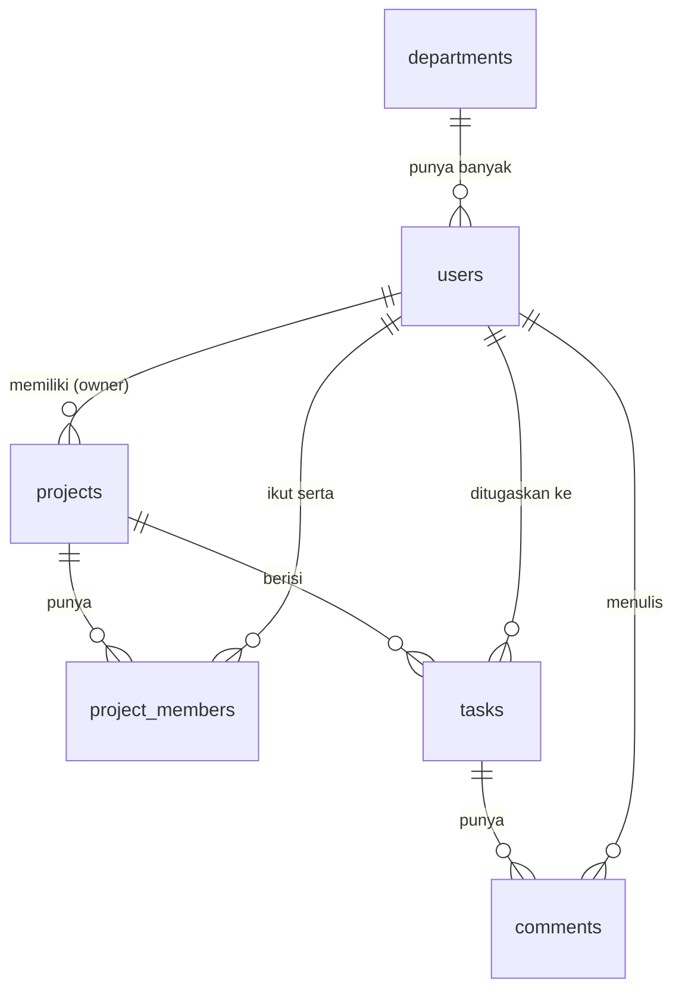

# Project Management REST API

REST API sederhana untuk mengelola project tim: department, user, project, task, dan komentar.
Dibuat dengan **FastAPI + SQLAlchemy + PostgreSQL**, di-deploy di **Vercel**.
Proyek ini adalah Tugas Akhir Learning Labs: Backend Development.

## Link

| Keterangan | URL |
|---|---|
| API (production) | https://backend-project-managementt.vercel.app |
| Swagger UI (dokumentasi interaktif) | https://backend-project-managementt.vercel.app/docs |

## Skema Database (ERD)


Ringkasan relasi:



| Tabel | Keterangan | Foreign Key |
|---|---|---|
| `departments` | Divisi/departemen | - |
| `users` | Pengguna | `department_id` -> departments |
| `projects` | Project | `owner_id` -> users |
| `project_members` | Tabel pivot **many-to-many** project <-> user | `project_id` -> projects, `user_id` -> users |
| `tasks` | Tugas dalam project | `project_id` -> projects, `assignee_id` -> users |
| `comments` | Komentar pada task | `task_id` -> tasks, `user_id` -> users |

SQL pembuatan tabel ada di [`schema.sql`](schema.sql).

## Aturan Umum

- Semua request dan response memakai **JSON**.
- Status code: `200` OK, `201` Created, `400` input salah, `404` data tidak ditemukan, `500` error server.
- Semua error berformat `{"error": "pesan error"}`.
- Nilai `status` project: `planning`, `ongoing`, `done`. Nilai `status` task: `todo`, `in_progress`, `done`.
- Resource dengan CRUD lengkap: **projects**, **users**, **tasks**.

## Daftar Endpoint

| Method | Endpoint | Fungsi |
|---|---|---|
| GET | `/` | Health check |
| GET, POST | `/departments` | Daftar / tambah department |
| GET, POST | `/users` | Daftar / tambah user |
| GET, PUT, DELETE | `/users/{id}` | Detail / ubah / hapus user |
| GET, POST | `/projects` | Daftar / tambah project |
| GET, PUT, DELETE | `/projects/{id}` | Detail / ubah / hapus project |
| GET, POST | `/projects/{id}/members` | Daftar / tambah member project |
| DELETE | `/projects/{id}/members/{user_id}` | Keluarkan member |
| GET, POST | `/tasks` | Daftar / tambah task |
| GET, PUT, DELETE | `/tasks/{id}` | Detail / ubah / hapus task |
| GET | `/tasks/{id}/comments` | Daftar komentar sebuah task |
| POST | `/comments` | Tambah komentar |
| DELETE | `/comments/{id}` | Hapus komentar |

## Detail Endpoint

### Health Check
```
Method        : GET
URL           : https://backend-project-managementt.vercel.app/
Deskripsi     : Mengecek server berjalan
Headers       : -
Request Body  : -
Response Sukses (200):
  {
    "status": "ok",
    "message": "FastAPI Server Running"
  }
```

### Daftar Department
```
Method        : GET
URL           : https://backend-project-managementt.vercel.app/departments
Deskripsi     : Mengambil semua department
Headers       : -
Request Body  : -
Response Sukses (200):
  {
    "message": "Data berhasil diambil",
    "data": [ { "id": 1, "name": "Engineering" } ]
  }
```

### Tambah Department
```
Method        : POST
URL           : https://backend-project-managementt.vercel.app/departments
Deskripsi     : Menambahkan department baru
Headers       : Content-Type: application/json
Request Body  :
  {
    "name": "Engineering"
  }
Response Sukses (201):
  {
    "message": "Department berhasil dibuat",
    "data": { "id": 1, "name": "Engineering" }
  }
Response Error (400):
  {
    "error": "Input tidak valid - name: String should have at least 1 character"
  }
```

### Daftar User
```
Method        : GET
URL           : https://backend-project-managementt.vercel.app/users
Deskripsi     : Mengambil semua user
Headers       : -
Request Body  : -
Response Sukses (200):
  {
    "message": "Data berhasil diambil",
    "data": [ { "id": 1, "name": "Budi", "email": "budi@example.com", "department_id": 1 } ]
  }
```

### Detail User
```
Method        : GET
URL           : https://backend-project-managementt.vercel.app/users/1
Deskripsi     : Mengambil satu user berdasarkan id
Headers       : -
Request Body  : -
Response Sukses (200):
  {
    "message": "Data ditemukan",
    "data": { "id": 1, "name": "Budi", "email": "budi@example.com", "department_id": 1 }
  }
Response Error (404):
  {
    "error": "User tidak ditemukan"
  }
```

### Tambah User
```
Method        : POST
URL           : https://backend-project-managementt.vercel.app/users
Deskripsi     : Menambahkan user baru (email harus unik)
Headers       : Content-Type: application/json
Request Body  :
  {
    "name": "Budi",
    "email": "budi@example.com",
    "department_id": 1
  }
Response Sukses (201):
  {
    "message": "User berhasil dibuat",
    "data": { "id": 1, "name": "Budi", "email": "budi@example.com", "department_id": 1 }
  }
Response Error (400):
  {
    "error": "Data tidak valid atau melanggar aturan database (contoh: email sudah dipakai)"
  }
```

### Ubah User
```
Method        : PUT
URL           : https://backend-project-managementt.vercel.app/users/1
Deskripsi     : Mengubah data user (field yang dikirim saja yang berubah)
Headers       : Content-Type: application/json
Request Body  :
  {
    "name": "Budi Santoso"
  }
Response Sukses (200):
  {
    "message": "User berhasil diperbarui",
    "data": { "id": 1, "name": "Budi Santoso", "email": "budi@example.com", "department_id": 1 }
  }
Response Error (404):
  {
    "error": "User tidak ditemukan"
  }
```

### Hapus User
```
Method        : DELETE
URL           : https://backend-project-managementt.vercel.app/users/1
Deskripsi     : Menghapus user
Headers       : -
Request Body  : -
Response Sukses (200):
  {
    "message": "User berhasil dihapus"
  }
Response Error (404):
  {
    "error": "User tidak ditemukan"
  }
```

### Daftar Project
```
Method        : GET
URL           : https://backend-project-managementt.vercel.app/projects
Deskripsi     : Mengambil semua project. Filter opsional: ?status=planning|ongoing|done
Headers       : -
Request Body  : -
Response Sukses (200):
  {
    "message": "Data berhasil diambil",
    "data": [ { "id": 1, "owner_id": 1, "title": "Website Kampus", "description": "Redesign website", "status": "planning" } ]
  }
```

### Detail Project
```
Method        : GET
URL           : https://backend-project-managementt.vercel.app/projects/1
Deskripsi     : Mengambil project beserta owner, members, dan tasks-nya
Headers       : -
Request Body  : -
Response Sukses (200):
  {
    "message": "Data ditemukan",
    "data": {
      "id": 1, "title": "Website Kampus", "status": "planning",
      "owner": { "id": 1, "name": "Budi" },
      "members": [ { "id": 2, "name": "Sari" } ],
      "tasks": [ { "id": 1, "title": "Buat desain homepage", "status": "todo" } ]
    }
  }
Response Error (404):
  {
    "error": "Project tidak ditemukan"
  }
```

### Tambah Project
```
Method        : POST
URL           : https://backend-project-managementt.vercel.app/projects
Deskripsi     : Membuat project baru
Headers       : Content-Type: application/json
Request Body  :
  {
    "title": "Website Kampus",
    "description": "Redesign website",
    "status": "planning",
    "owner_id": 1
  }
Response Sukses (201):
  {
    "message": "Project berhasil dibuat",
    "data": { "id": 1, "owner_id": 1, "title": "Website Kampus", "description": "Redesign website", "status": "planning" }
  }
Response Error (400):
  {
    "error": "Input tidak valid - title: Field required"
  }
```

### Ubah Project
```
Method        : PUT
URL           : https://backend-project-managementt.vercel.app/projects/1
Deskripsi     : Mengubah project (field yang dikirim saja yang berubah)
Headers       : Content-Type: application/json
Request Body  :
  {
    "status": "ongoing"
  }
Response Sukses (200):
  {
    "message": "Project berhasil diperbarui",
    "data": { "id": 1, "owner_id": 1, "title": "Website Kampus", "description": "Redesign website", "status": "ongoing" }
  }
Response Error (404):
  {
    "error": "Project tidak ditemukan"
  }
```

### Hapus Project
```
Method        : DELETE
URL           : https://backend-project-managementt.vercel.app/projects/1
Deskripsi     : Menghapus project (task & member ikut terhapus)
Headers       : -
Request Body  : -
Response Sukses (200):
  {
    "message": "Project berhasil dihapus"
  }
Response Error (404):
  {
    "error": "Project tidak ditemukan"
  }
```

### Daftar Member Project
```
Method        : GET
URL           : https://backend-project-managementt.vercel.app/projects/1/members
Deskripsi     : Mengambil semua anggota project
Headers       : -
Request Body  : -
Response Sukses (200):
  {
    "message": "Data berhasil diambil",
    "data": [ { "id": 2, "name": "Sari", "email": "sari@example.com", "department_id": 1 } ]
  }
Response Error (404):
  {
    "error": "Project tidak ditemukan"
  }
```

### Tambah Member Project
```
Method        : POST
URL           : https://backend-project-managementt.vercel.app/projects/1/members
Deskripsi     : Menambahkan user sebagai anggota project
Headers       : Content-Type: application/json
Request Body  :
  {
    "user_id": 2
  }
Response Sukses (201):
  {
    "message": "Member berhasil ditambahkan",
    "data": { "project_id": 1, "user_id": 2 }
  }
Response Error (400):
  {
    "error": "User sudah menjadi member project ini"
  }
```

### Hapus Member Project
```
Method        : DELETE
URL           : https://backend-project-managementt.vercel.app/projects/1/members/2
Deskripsi     : Mengeluarkan user dari project
Headers       : -
Request Body  : -
Response Sukses (200):
  {
    "message": "Member berhasil dihapus dari project"
  }
Response Error (404):
  {
    "error": "Member tidak ditemukan"
  }
```

### Daftar Task
```
Method        : GET
URL           : https://backend-project-managementt.vercel.app/tasks
Deskripsi     : Mengambil semua task. Filter opsional: ?project_id=1
Headers       : -
Request Body  : -
Response Sukses (200):
  {
    "message": "Data berhasil diambil",
    "data": [ { "id": 1, "project_id": 1, "assignee_id": 2, "title": "Buat desain homepage", "status": "todo" } ]
  }
```

### Detail Task
```
Method        : GET
URL           : https://backend-project-managementt.vercel.app/tasks/1
Deskripsi     : Mengambil satu task
Headers       : -
Request Body  : -
Response Sukses (200):
  {
    "message": "Data ditemukan",
    "data": { "id": 1, "project_id": 1, "assignee_id": 2, "title": "Buat desain homepage", "status": "todo" }
  }
Response Error (404):
  {
    "error": "Task tidak ditemukan"
  }
```

### Tambah Task
```
Method        : POST
URL           : https://backend-project-managementt.vercel.app/tasks
Deskripsi     : Membuat task baru di sebuah project
Headers       : Content-Type: application/json
Request Body  :
  {
    "project_id": 1,
    "title": "Buat desain homepage",
    "status": "todo",
    "assignee_id": 2
  }
Response Sukses (201):
  {
    "message": "Task berhasil dibuat",
    "data": { "id": 1, "project_id": 1, "assignee_id": 2, "title": "Buat desain homepage", "status": "todo" }
  }
Response Error (400):
  {
    "error": "Project dengan id 999 tidak ditemukan"
  }
```

### Ubah Task
```
Method        : PUT
URL           : https://backend-project-managementt.vercel.app/tasks/1
Deskripsi     : Mengubah task. status: todo | in_progress | done
Headers       : Content-Type: application/json
Request Body  :
  {
    "status": "in_progress"
  }
Response Sukses (200):
  {
    "message": "Task berhasil diperbarui",
    "data": { "id": 1, "project_id": 1, "assignee_id": 2, "title": "Buat desain homepage", "status": "in_progress" }
  }
Response Error (404):
  {
    "error": "Task tidak ditemukan"
  }
```

### Hapus Task
```
Method        : DELETE
URL           : https://backend-project-managementt.vercel.app/tasks/1
Deskripsi     : Menghapus task (komentarnya ikut terhapus)
Headers       : -
Request Body  : -
Response Sukses (200):
  {
    "message": "Task berhasil dihapus"
  }
Response Error (404):
  {
    "error": "Task tidak ditemukan"
  }
```

### Daftar Komentar Task
```
Method        : GET
URL           : https://backend-project-managementt.vercel.app/tasks/1/comments
Deskripsi     : Mengambil semua komentar pada sebuah task
Headers       : -
Request Body  : -
Response Sukses (200):
  {
    "message": "Data berhasil diambil",
    "data": [ { "id": 1, "task_id": 1, "user_id": 1, "content": "Tolong selesaikan minggu ini" } ]
  }
Response Error (404):
  {
    "error": "Task tidak ditemukan"
  }
```

### Tambah Komentar
```
Method        : POST
URL           : https://backend-project-managementt.vercel.app/comments
Deskripsi     : Menambahkan komentar pada task
Headers       : Content-Type: application/json
Request Body  :
  {
    "task_id": 1,
    "user_id": 1,
    "content": "Tolong selesaikan minggu ini"
  }
Response Sukses (201):
  {
    "message": "Komentar berhasil ditambahkan",
    "data": { "id": 1, "task_id": 1, "user_id": 1, "content": "Tolong selesaikan minggu ini" }
  }
Response Error (400):
  {
    "error": "Task dengan id 999 tidak ditemukan"
  }
```

### Hapus Komentar
```
Method        : DELETE
URL           : https://backend-project-managementt.vercel.app/comments/1
Deskripsi     : Menghapus komentar
Headers       : -
Request Body  : -
Response Sukses (200):
  {
    "message": "Komentar berhasil dihapus"
  }
Response Error (404):
  {
    "error": "Komentar tidak ditemukan"
  }
```

## Cara Menjalankan Secara Lokal

1. Clone repository dan masuk ke foldernya.
   ```bash
   git clone https://github.com/thomsboy555/backend-project-managementt.git
   cd backend-project-managementt
   ```
2. Buat virtual environment dan install dependency.
   ```bash
   python -m venv venv
   source venv/bin/activate      # Windows: venv\Scripts\activate
   pip install -r requirements.txt
   ```
3. Salin `.env.example` menjadi `.env`, lalu isi `DATABASE_URL` dengan connection string PostgreSQL (Supabase / Neon).
4. Buat tabel: jalankan isi `schema.sql` di SQL Editor database (atau biarkan aplikasi membuat tabel yang belum ada saat pertama dijalankan).
5. Jalankan server.
   ```bash
   uvicorn main:app --reload
   ```
6. Buka http://localhost:8000/docs untuk mencoba API.

## Deployment (Vercel)

1. Push project ke GitHub, lalu import repository di Vercel.
2. Di **Settings > Environment Variables**, tambahkan `DATABASE_URL`.
3. Deploy. Konfigurasi ada di `vercel.json`.

## Pengujian

Import file [`docs/postman_collection.json`](docs/postman_collection.json) ke Postman/Thunder Client, lalu jalankan semua request berurutan. Bukti screenshot ada di folder `docs/screenshots/`.
